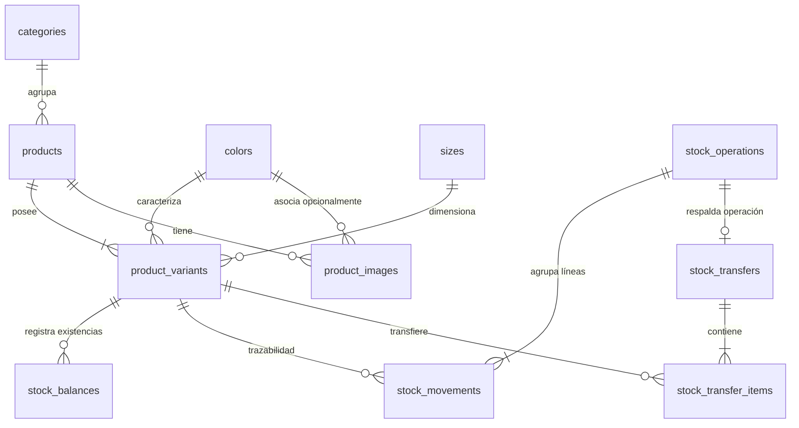

# KIMENTS POS — MS-02 Catálogo e Inventario
## Arquitectura de Software, Patrones de Diseño y Modelo Relacional

---

## 1. Visión General de la Arquitectura

El microservicio **MS-02 Catálogo e Inventario** (`kiments-catalog-inventory-service`) ha sido diseñado como un único artefacto desplegable Spring Boot con arquitectura en capas orientada al dominio y separación interna de funcionalidades en dos módulos de negocio: **Catálogo** e **Inventario**.

```
com.kiments.cataloginventory
├── catalog
│   ├── controller      # Controladores REST delgados
│   ├── domain          # Entidades JPA de catálogo (Category, Color, Size, Product, ProductVariant, ProductImage)
│   ├── dto             # Records inmutables para peticiones y respuestas
│   ├── repository       # Interfaces Spring Data JPA
│   └── service         # Interfaces de casos de uso e implementaciones transaccionales
├── inventory
│   ├── controller      # Controladores REST de stock, movimientos, traspasos y reportes
│   ├── domain          # Entidades JPA de inventario (StockBalance, StockOperation, StockMovement, StockTransfer)
│   ├── dto             # Records de ajustes, traspasos y balances
│   ├── repository       # Repositorios JPA con soporte de bloqueo pesimista ordenado
│   └── service         # Casos de uso transaccionales de control de stock y traspasos
├── security            # OAuth2 Resource Server, convertidor JWT, validación de sucursales
├── ports
│   ├── storage         # Puerto StoragePort y adaptador LocalStorageAdapter
│   └── auth            # Puerto AuthClientPort y adaptador AuthClientAdapter
├── shared
│   ├── idempotency     # Soporte persistente de Idempotency-Key
│   ├── BarcodeGenerator# Generador y validador EAN-13 estándar Módulo 10
│   ├── SkuGenerator    # Generador seguro de SKU basado en secuencia PostgreSQL
│   └── ExcelExportService # Exportador XLSX (POI) con sanitización contra inyección de fórmulas
└── config              # Seguridad, OpenAPI, CORS, correlación MDC y propiedades
```

---

## 2. Patrones de Diseño Aplicados y Justificación

### 2.1. Layered Architecture (Arquitectura en Capas)
* **Problema que resuelve:** Evita el acoplamiento entre la exposición HTTP, la lógica de negocio y el acceso a datos.
* **Clases:** `*Controller` → `*Service` / `*ServiceImpl` → `*Repository` → `*Entity`.
* **Beneficio:** Los controladores no contienen lógica transaccional ni consultas a la base de datos; delegan en los servicios, que demarcan las transacciones (`@Transactional`).

### 2.2. DTO / Mapper Pattern
* **Problema que resuelve:** Aísla el modelo relacional interno de la API pública REST, evitando exponer campos internos o relaciones Hibernate que generen problemas de serialización o vulnerabilidades de asignación masiva (Mass Assignment).
* **Clases:** `ProductDtos`, `CategoryDtos`, `ColorDtos`, `SizeDtos`, `InventoryDtos`. Todos implementados como `record` de Java 21, inmutables y validados mediante Bean Validation (`@Valid`, `@NotNull`, `@Min`, etc.).

### 2.3. Repository Pattern
* **Problema que resuelve:** Abstrae las consultas SQL y el ciclo de vida de persistencia de las entidades.
* **Clases:** `ProductRepository`, `ProductVariantRepository`, `StockBalanceRepository`, etc. usando Spring Data JPA. Provee métodos tipados y consultas optimizadas que evitan problemas de N+1 mediante `JOIN FETCH`.

### 2.4. Port and Adapter Pattern (Hexagonal / Clean Architecture)
* **Problema que resuelve:** Desacopla las dependencias externas (almacenamiento de archivos y verificación de sesión con el servicio de autenticación) de la lógica de dominio.
* **Clases involucradas:**
  - `StoragePort` (interfaz de dominio) ← `LocalStorageAdapter` (implementación local actual, intercambiable en el futuro por `AzureBlobStorageAdapter` o `S3StorageAdapter` sin alterar el dominio).
  - `AuthClientPort` (interfaz) ← `AuthClientAdapter` (implementación HTTP con timeouts que aísla la comunicación con `kiments-auth-service`).

### 2.5. Pessimistic Locking with Deterministic Ordering (Control de Concurrencia)
* **Problema que resuelve:** Previene condiciones de carrera en salidas de stock concurrentes y traspasos simultáneos, además de erradicar deadlocks en la base de datos cuando dos transacciones intentan bloquear los mismos recursos en distinto orden.
* **Implementación:** `StockBalanceRepository.findByVariantIdAndBranchIdForUpdate(...)`. En traspasos de múltiples variantes, la lista de `variantId` se ordena de manera determinista (alfabéticamente por UUID) antes de adquirir los bloqueos `SELECT ... FOR UPDATE`.

### 2.6. Idempotent Receiver Pattern (Idempotencia Persistente)
* **Problema que resuelve:** Evita que fallos de red, reintentos del cliente o doble clic dupliquen la creación de productos, ajustes de inventario o traspasos.
* **Clases:** `IdempotencyService`, `IdempotencyRecord`, `IdempotencyRepository`.
* **Funcionamiento:** Calcula un hash SHA-256 del cuerpo de la petición y lo asocia a `(Idempotency-Key, actorUserId, endpoint)` con restricción única en base de datos.
  - Misma clave y mismo hash: retorna la respuesta almacenada previamente sin re-ejecutar.
  - Misma clave y hash diferente: retorna `409 Conflict`.

---

## 3. Modelo Relacional PostgreSQL (Esquema `catalog_inventory`)

El servicio es propietario exclusivo del esquema `catalog_inventory` dentro de PostgreSQL. No realiza joins, consultas ni claves foráneas físicas contra el esquema `auth`. Las referencias a `user_id` y `branch_id` son UUID externos.



### 3.1. Detalle de Tablas

#### `catalog_inventory.categories`
| Campo | Tipo | Restricción | Descripción |
|---|---|---|---|
| `id` | UUID | PRIMARY KEY | Identificador único |
| `name` | VARCHAR(80) | NOT NULL, UNIQUE (ci) | Nombre normalizado de la categoría |
| `description` | VARCHAR(500) | NULL | Descripción opcional |
| `enabled` | BOOLEAN | NOT NULL DEFAULT true | Borrado lógico / estado |
| `created_at` | TIMESTAMPTZ | NOT NULL | Fecha de creación ISO 8601 |
| `updated_at` | TIMESTAMPTZ | NOT NULL | Fecha de modificación |
| `version` | BIGINT | NOT NULL DEFAULT 0 | Control de concurrencia optimista |

#### `catalog_inventory.colors`
| Campo | Tipo | Restricción | Descripción |
|---|---|---|---|
| `id` | UUID | PRIMARY KEY | Identificador único |
| `name` | VARCHAR(50) | NOT NULL, UNIQUE (ci) | Nombre del color |
| `hex` | VARCHAR(7) | NOT NULL, CHECK (#RRGGBB) | Código hexadecimal del color |
| `enabled` | BOOLEAN | NOT NULL DEFAULT true | Borrado lógico |
| `created_at` / `updated_at` | TIMESTAMPTZ | NOT NULL | Marcas de tiempo |
| `version` | BIGINT | NOT NULL DEFAULT 0 | Bloqueo optimista |

#### `catalog_inventory.sizes`
| Campo | Tipo | Restricción | Descripción |
|---|---|---|---|
| `id` | UUID | PRIMARY KEY | Identificador único |
| `name` | VARCHAR(30) | NOT NULL, UNIQUE (ci) | Nombre de la talla (ej. XS, S, M, L) |
| `sort_order` | INT | NOT NULL DEFAULT 0 | Orden visual de presentación |
| `enabled` | BOOLEAN | NOT NULL DEFAULT true | Borrado lógico |
| `created_at` / `updated_at` | TIMESTAMPTZ | NOT NULL | Marcas de tiempo |
| `version` | BIGINT | NOT NULL DEFAULT 0 | Bloqueo optimista |

#### `catalog_inventory.products`
| Campo | Tipo | Restricción | Descripción |
|---|---|---|---|
| `id` | UUID | PRIMARY KEY | Identificador único del producto |
| `category_id` | UUID | FK categories(id) ON DELETE RESTRICT | Categoría asociada |
| `name` | VARCHAR(120) | NOT NULL | Nombre comercial del producto |
| `description` | VARCHAR(1000) | NULL | Detalle o composición |
| `enabled` | BOOLEAN | NOT NULL DEFAULT true | Estado activo/inactivo |
| `auto_sku` | BOOLEAN | NOT NULL DEFAULT false | Bandera de generación automática de SKU |
| `auto_barcode` | BOOLEAN | NOT NULL DEFAULT false | Bandera de generación automática de EAN-13 |
| `created_at` / `updated_at` | TIMESTAMPTZ | NOT NULL | Marcas de tiempo |
| `version` | BIGINT | NOT NULL DEFAULT 0 | Bloqueo optimista |

#### `catalog_inventory.product_variants`
| Campo | Tipo | Restricción | Descripción |
|---|---|---|---|
| `id` | UUID | PRIMARY KEY | Identificador de variante |
| `product_id` | UUID | FK products(id) ON DELETE RESTRICT | Producto padre |
| `color_id` | UUID | FK colors(id) ON DELETE RESTRICT | Atributo de color |
| `size_id` | UUID | FK sizes(id) ON DELETE RESTRICT | Atributo de talla |
| `sku` | VARCHAR(60) | NOT NULL, UNIQUE | Código SKU único |
| `barcode` | VARCHAR(60) | UNIQUE (where not null) | Código de barras único |
| `price` | NUMERIC(12,2) | NOT NULL, CHECK (>= 0) | Precio regular de venta |
| `wholesale_price` | NUMERIC(12,2) | CHECK (NULL or >= 0) | Precio mayorista opcional |
| `enabled` | BOOLEAN | NOT NULL DEFAULT true | Estado de la variante |
| `created_at` / `updated_at` | TIMESTAMPTZ | NOT NULL | Marcas de tiempo |
| `version` | BIGINT | NOT NULL DEFAULT 0 | Bloqueo optimista |
* Restricción única compuesta: `UNIQUE (product_id, color_id, size_id)`.

#### `catalog_inventory.product_images`
| Campo | Tipo | Restricción | Descripción |
|---|---|---|---|
| `id` | UUID | PRIMARY KEY | Identificador de fotografía |
| `product_id` | UUID | FK products(id) ON DELETE CASCADE | Producto al que pertenece |
| `color_id` | UUID | FK colors(id) ON DELETE SET NULL | Color asociado (NULL si es global) |
| `storage_key` | VARCHAR(255) | NOT NULL, UNIQUE | Clave física interna de almacenamiento |
| `mime_type` | VARCHAR(50) | NOT NULL | Tipo MIME validado (image/jpeg, png, webp) |
| `byte_size` | BIGINT | NOT NULL CHECK (> 0) | Tamaño en bytes |
| `width` / `height` | INT | NOT NULL CHECK (> 0) | Dimensiones en píxeles |
| `sort_order` | INT | NOT NULL DEFAULT 0 | Orden relativo |
| `created_at` | TIMESTAMPTZ | NOT NULL | Fecha de carga |
* Restricción única parcial: `UNIQUE (product_id) WHERE color_id IS NULL` (máximo 1 global).
* Regla de negocio: máximo 5 imágenes por color dentro del producto.

#### `catalog_inventory.stock_balances`
| Campo | Tipo | Restricción | Descripción |
|---|---|---|---|
| `id` | UUID | PRIMARY KEY | Identificador de balance |
| `variant_id` | UUID | FK product_variants(id) ON DELETE RESTRICT | Variante |
| `branch_id` | UUID | NOT NULL | Referencia externa a auth.branches |
| `quantity` | INT | NOT NULL, CHECK (quantity >= 0) | Cantidad disponible (garantía no negativa) |
| `version` | BIGINT | NOT NULL DEFAULT 0 | Versión de fila |
| `updated_at` | TIMESTAMPTZ | NOT NULL | Fecha de última actualización |
* Restricción única: `UNIQUE (variant_id, branch_id)`.

#### `catalog_inventory.stock_operations`
| Campo | Tipo | Restricción | Descripción |
|---|---|---|---|
| `id` | UUID | PRIMARY KEY | Identificador de cabecera de operación |
| `type` | VARCHAR(30) | NOT NULL | INITIAL_STOCK, MANUAL_IN, MANUAL_OUT, TRANSFER_OUT... |
| `actor_user_id` | UUID | NOT NULL | Usuario responsable de la operación |
| `source` | VARCHAR(30) | NOT NULL DEFAULT 'MANUAL' | Origen (MANUAL, TRANSFER, SYSTEM, SALE) |
| `reference_type` | VARCHAR(50) | NULL | Tipo de entidad externa de referencia |
| `reference_id` | VARCHAR(100) | NULL | Identificador externo o correlativo |
| `reason` | VARCHAR(255) | NULL | Motivo justificado del movimiento |
| `occurred_at` | TIMESTAMPTZ | NOT NULL | Momento exacto de ocurrencia |
| `correlation_id`| VARCHAR(64) | NULL | ID de correlación de la petición |

#### `catalog_inventory.stock_movements`
| Campo | Tipo | Restricción | Descripción |
|---|---|---|---|
| `id` | UUID | PRIMARY KEY | Identificador de movimiento |
| `operation_id` | UUID | FK stock_operations(id) | Operación padre |
| `variant_id` | UUID | FK product_variants(id) | Variante afectada |
| `branch_id` | UUID | NOT NULL | Sucursal donde ocurre el movimiento |
| `before_quantity`| INT | NOT NULL CHECK (>= 0) | Existencias antes del movimiento |
| `delta` | INT | NOT NULL | Variación neta (+ o -) |
| `after_quantity` | INT | NOT NULL CHECK (>= 0) | Existencias tras el movimiento |
| `product_name` | VARCHAR(120) | NOT NULL | Snapshot del nombre del producto |
| `variant_detail`| VARCHAR(150) | NOT NULL | Snapshot (color / talla — SKU) |
| `user_name` | VARCHAR(160) | NOT NULL | Snapshot del usuario responsable |
| `branch_name` | VARCHAR(100) | NOT NULL | Snapshot de la sucursal |
| `destination_branch_name` | VARCHAR(100) | NULL | Snapshot de sucursal destino si fue traspaso |

#### `catalog_inventory.stock_transfers` y `stock_transfer_items`
* `stock_transfers`: Cabecera de traspasos entre `origin_branch_id` y `destination_branch_id` con restricción `CHECK (origin_branch_id <> destination_branch_id)`.
* `stock_transfer_items`: Detalle por variante con `quantity > 0` y `UNIQUE (transfer_id, variant_id)`.

#### `catalog_inventory.idempotency_records`
* Almacena `(idempotency_key, actor_user_id, endpoint)` con restricción única y hash SHA-256 de la petición.
