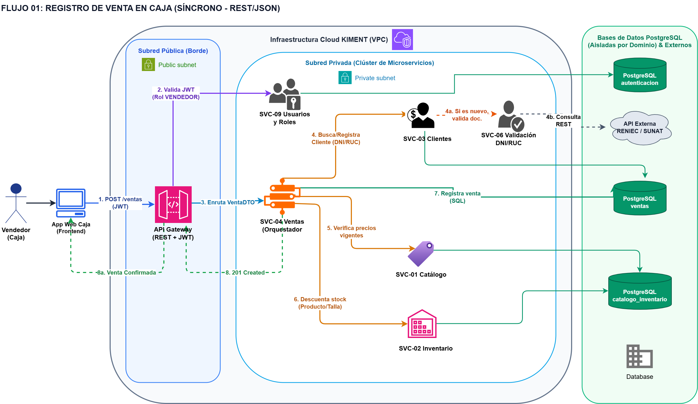

# 03. Flujo 01: Registro de Venta en Caja (Síncrono - REST/JSON)

> 📌 [Ver imagen en tamaño completo](./03-diagrama-flujo-01-venta-en-caja.png)

## 1. Visión General del Flujo Síncrono
Este flujo describe la interacción en tiempo real que se ejecuta mientras el cliente se encuentra en la caja registradora. Representa el ciclo completo desde que el vendedor envía la orden de compra hasta que recibe la confirmación en pantalla (`201 Created`).

El proceso utiliza un **Microservicio Orquestador (`SVC-04 Ventas`)** que coordina de forma secuencial y síncrona las llamadas HTTP/REST (JSON) dentro de la subred privada, garantizando consistencia inmediata en precios y stock sin bloquear la atención en caja por procesos externos como SUNAT o envío de correos (los cuales se delegan de forma desacoplada al **Flujo 02: Facturación Electrónica**).

---

## 2. Participantes y Componentes del Flujo
- **Vendedor (Caja) & App Web Caja (Frontend):** Interfaz en el punto de venta que inicia la solicitud `POST /ventas` adjuntando el token JWT.
- **API Gateway (Subred Pública):** Punto único de entrada a la VPC que valida seguridad, enruta peticiones hacia la subred privada y retorna las respuestas al cliente.
- **SVC-09 Usuarios y Roles:** Microservicio que verifica la validez del token JWT y autoriza el rol `VENDEDOR` contra la base de datos `autenticacion`.
- **SVC-04 Ventas (Orquestador):** Microservicio central que coordina la transacción de venta y persiste los registros en la base de datos `ventas`.
- **SVC-03 Clientes:** Microservicio que consulta o registra los datos del comprador en la base de datos `ventas`.
- **SVC-06 Validación DNI/RUC:** Servicio utilitario que consulta APIs externas (RENIEC / SUNAT) cuando se trata de un cliente nuevo.
- **SVC-01 Catálogo:** Microservicio que provee los precios vigentes de los productos desde `catalogo_inventario`.
- **SVC-02 Inventario:** Microservicio que descuenta el stock disponible por producto y talla en `catalogo_inventario`.
- **Bases de Datos PostgreSQL (Aisladas por Dominio):** `autenticacion`, `ventas` y `catalogo_inventario`.

---

## 3. Secuencia Detallada de Interacciones (Pasos 1 – 8a)

### A. Entrada y Seguridad en el Borde (Pasos 1 – 3)
1. **Solicitud desde Caja:** El **Vendedor** registra las prendas en la **App Web Caja** y envía `POST /ventas` con el payload de la venta y su **Token JWT** hacia el **API Gateway** (Subred Pública).
2. **Validación de Acceso:** El **API Gateway** consulta a **SVC-09 Usuarios y Roles** (conectado a `PostgreSQL: autenticacion`) para verificar la firma del JWT y confirmar el rol `VENDEDOR`.
3. **Enrutamiento Privado:** Una vez autorizado, el **API Gateway** enruta el `VentaDTO` hacia **SVC-04 Ventas** dentro de la Subred Privada.

### B. Identificación y Validación del Cliente (Pasos 4 – 4b)
4. **Consulta o Registro de Cliente:** **SVC-04 Ventas** invoca a **SVC-03 Clientes** enviando el número de DNI o RUC:
   - **4a. Validación Documental (Cliente Nuevo):** Si el cliente no existe en `PostgreSQL: ventas`, **SVC-03** solicita a **SVC-06 Validación DNI/RUC** la verificación del documento.
   - **4b. Consulta Externa REST:** **SVC-06** consulta el padrón externo de **RENIEC / SUNAT**, retorna los datos validados y **SVC-03** registra al cliente en `PostgreSQL: ventas`.

### C. Verificación de Precios y Descuento de Stock (Pasos 5 – 6)
5. **Verificación de Precios:** **SVC-04 Ventas** consulta a **SVC-01 Catálogo** para confirmar los precios unitarios vigentes desde `PostgreSQL: catalogo_inventario`.
6. **Actualización de Inventario:** **SVC-04 Ventas** solicita a **SVC-02 Inventario** el descuento de unidades por producto y talla, actualizando el stock disponible en `PostgreSQL: catalogo_inventario`.

### D. Persistencia Transaccional y Respuesta al Cliente (Pasos 7 – 8a)
7. **Registro de Venta:** **SVC-04 Ventas** persiste la cabecera y el detalle de la transacción en `PostgreSQL: ventas` con estado `REGISTRADA`.
8. **Respuesta al Gateway:** **SVC-04 Ventas** devuelve `201 Created` hacia el **API Gateway**.
9. **8a. Confirmación en Pantalla:** El **API Gateway** traslada la respuesta a la **App Web Caja**, mostrando la venta confirmada al vendedor.

---

## 4. Beneficios Técnicos del Diseño
- **Aislamiento de Red (VPC):** El cliente nunca accede directamente a los microservicios ni a las bases de datos; toda entrada y salida atraviesa el **API Gateway** en la subred pública.
- **Consistencia Inmediata en Caja:** Garantiza que no se confirme ninguna venta sin validar previamente identidad, precios vigentes y disponibilidad real de stock por talla.
- **Separación de Responsabilidades (Database-per-Domain):** Cada dominio gestiona su propia instancia PostgreSQL (`autenticacion`, `ventas`, `catalogo_inventario`), evitando acoplamiento directo entre esquemas.