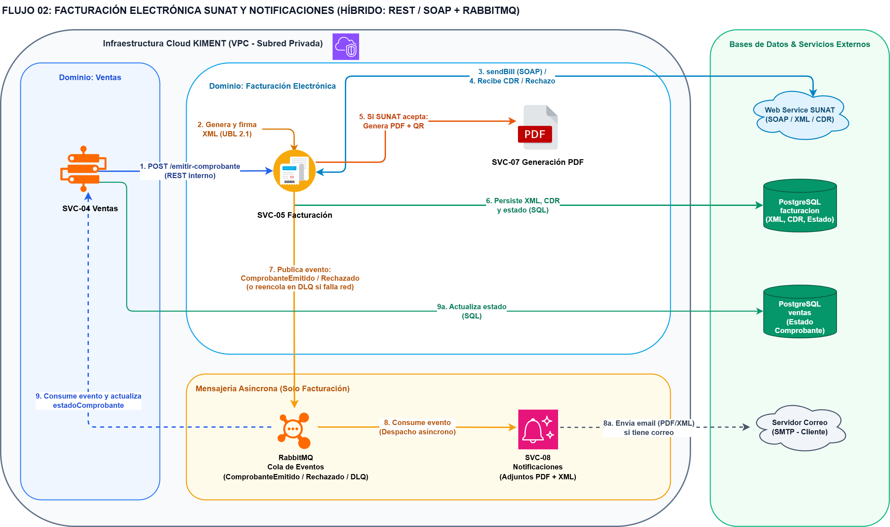

# 04. Flujo 02: Facturación Electrónica SUNAT y Notificaciones (Híbrido: REST / SOAP + RabbitMQ)

> 📌 [Ver imagen en tamaño completo](./04-diagrama-flujo-02-facturacion.png)

## 1. Visión General del Flujo Híbrido
Este flujo describe el procesamiento tributario y de notificaciones que se desencadena tras registrar una venta. Combina comunicación **síncrona (REST / SOAP)** para la validación fiscal inmediata con la **SUNAT** y generación del comprobante PDF, junto con mensajería **asíncrona (RabbitMQ)** para desacoplar el envío de correos electrónicos y la actualización de estados en el dominio de ventas.

De este modo, la infraestructura garantiza cumplimiento tributario automatizado en estándar **UBL 2.1**, tolerancia a fallos mediante políticas de reintento (**DLQ**) y aislamiento total frente a latencias de servicios externos (SUNAT y servidor SMTP).

---

## 2. Participantes y Componentes del Flujo
- **SVC-04 Ventas (Dominio: Ventas):** Microservicio que solicita la emisión del comprobante tras registrar la venta y actualiza su estado final en `PostgreSQL: ventas`.
- **SVC-05 Facturación (Dominio: Facturación Electrónica):** Microservicio orquestador tributario que construye y firma el XML (UBL 2.1), se comunica con SUNAT y persiste la respuesta en `PostgreSQL: facturacion`.
- **Web Service SUNAT (SOAP):** Entidad fiscalizadora externa que valida el comprobante electrónico y emite la Constancia de Recepción (CDR) o el código de rechazo.
- **SVC-07 Generación PDF:** Servicio utilitario que compila los datos del comprobante y la CDR para generar el documento PDF con código QR normativo.
- **RabbitMQ (Mensajería Asíncrona):** Broker de eventos exclusivo de facturación que gestiona las colas `ComprobanteEmitido`, `ComprobanteRechazado` y `DLQ` (Dead Letter Queue).
- **SVC-08 Notificaciones:** Microservicio consumidor que envía los adjuntos (PDF y XML) al correo electrónico del cliente a través del servidor SMTP.
- **Bases de Datos PostgreSQL (Aisladas por Dominio):** `facturacion` (XML, CDR, estado) y `ventas` (estado del comprobante).

---

## 3. Secuencia Detallada de Interacciones (Pasos 1 – 9a)

### A. Solicitud, Firma Digital e Integración SUNAT (Pasos 1 – 4)
1. **Solicitud de Emisión:** **SVC-04 Ventas** realiza una petición interna `POST /emitir-comprobante` (REST) hacia **SVC-05 Facturación** con los datos de la venta registrada.
2. **Construcción y Firma XML:** **SVC-05 Facturación** transforma los datos al estándar tributario **UBL 2.1** y aplica la firma digital ($XMLDSig$).
3. **Envío Tributario (`sendBill`):** **SVC-05 Facturación** invoca por **SOAP** al **Web Service SUNAT** enviando el XML firmado.
4. **Recepción de Respuesta:** **SUNAT** valida la trama y retorna la **CDR (Constancia de Recepción)** si es aceptada, o el código de error si es rechazada.

### B. Renderizado PDF y Persistencia Tributaria (Pasos 5 – 6)
5. **Generación de Comprobante PDF:** Si **SUNAT** acepta el comprobante, **SVC-05 Facturación** invoca a **SVC-07 Generación PDF** para generar el archivo PDF con su código QR oficial.
6. **Persistencia en Base de Datos:** **SVC-05 Facturación** guarda el XML firmado, la CDR y el estado tributario en `PostgreSQL: facturacion`.

### C. Publicación de Eventos y Despacho Asíncrono (Pasos 7 – 9a)
7. **Publicación en Broker:** **SVC-05 Facturación** publica en **RabbitMQ** el evento `ComprobanteEmitido` o `ComprobanteRechazado` (o reencola el mensaje en **DLQ** si ocurrió un fallo de red o *timeout* con SUNAT).
8. **Consumo para Notificación:** **SVC-08 Notificaciones** consume el evento `ComprobanteEmitido` de forma asíncrona desde **RabbitMQ**:
   - **8a. Envío por Correo (SMTP):** Si el cliente tiene un correo electrónico registrado, **SVC-08** despacha el email adjuntando el PDF y el XML a través del **Servidor Correo (SMTP)**; de lo contrario, omite el envío quedando disponible para impresión física.
9. **Consumo en Dominio de Ventas:** **SVC-04 Ventas** consume el evento desde **RabbitMQ** para sincronizar el resultado de la emisión.
   - **9a. Actualización de Estado:** **SVC-04 Ventas** actualiza el atributo `estadoComprobante` (`EMITIDO` o `RECHAZADO`) en `PostgreSQL: ventas`.

---

## 4. Beneficios Técnicos del Diseño Híbrido
- **Desacoplamiento por Eventos (RabbitMQ):** El envío de correos electrónicos (`SVC-08`) y la actualización de estado en ventas (`SVC-04`) se ejecutan en segundo plano sin bloquear el flujo tributario principal.
- **Resiliencia ante Caídas Externas:** El uso de colas de reintento (**DLQ**) en RabbitMQ evita la pérdida de comprobantes ante intermitencias del Web Service SOAP de SUNAT.
- **Aislamiento de Datos por Dominio:** La información fiscal sensible (XML firmado y CDR) se almacena exclusivamente en `PostgreSQL: facturacion`, separada de la operación comercial en `PostgreSQL: ventas`.